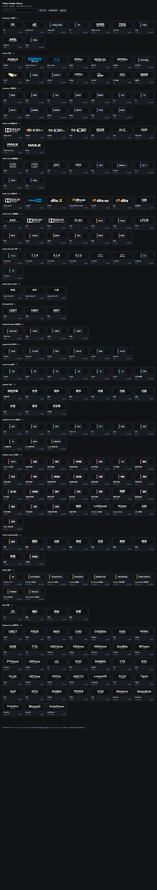

# zPlayer Badge Library

一份可直接由 zPlayer 导入的社区徽章库，同时提供 GitHub Pages 预览页。

当前版本包含 **214 枚徽章、20 个分组**。`badges.json` 使用相对图片路径，zPlayer 会以徽章库 URL 为基准解析这些路径。



## 快速使用

部署到 GitHub Pages 后，在 zPlayer 的「徽章库 → 从链接导入」中填入：

```text
https://<你的用户名>.github.io/<仓库名>/badges.json
```

预览页是同一地址的目录页：

```text
https://<你的用户名>.github.io/<仓库名>/
```

页面右上角有「复制徽章库地址」按钮，复制后可以直接粘贴到 zPlayer。

## 当前分组

| 分组 | 数量 | 示例 |
| --- | ---: | --- |
| Resolution 分辨率 | 9 | 8K、4K、1440p、2K、1080p、720p、576p、480p、360p |
| Source 片源 | 14 | REMUX、UHD Blu-ray、Blu-ray、WEB-DL、WEBRip、HDTVRip、TVRip、ISO |
| Container 封装格式 | 13 | MKV、MP4、AVI、MOV、WMV、FLV、TS、M2TS、WEBM、RMVB、MPEG、VOB、M4V |
| Video Tech 视频技术 | 9 | Dolby Vision、HDR10+、HDR10、HLG、HDR Vivid、IMAX Enhanced |
| Video Codec 视频编码 | 9 | HEVC、AVC、AV1、VVC、VP9、MPEG-2、VC-1、XviD、DivX |
| Audio Tech 音频技术 | 7 | Atmos、TrueHD、DTS:X、DTS-HD MA、DTS-HD、DTS、无损 |
| Audio Codec 音频编码 | 13 | AAC、AC3、EAC3、FLAC、ALAC、Opus、PCM、MP3、Vorbis、WMA、APE、WAV、MP2 |
| Audio Channels 声道 | 8 | 9.1.6、7.1.4、5.1.4、5.1.2、7.1、5.1、2.0、1.0 |
| Dolby Vision Profile | 3 | P5、P7、P8 |
| Bit Depth 位深 | 3 | 12Bit、10Bit、8Bit |
| Audio Bit Depth 音频位深 | 4 | 16Bit、24Bit、32Bit、32Bit Float |
| Sample Rate 采样率 | 6 | 44.1、48、88.2、96、176.4、192 kHz |
| Frame Rate 帧率 | 7 | 120、60、50、30、25、24 fps、HFR |
| Subtitle 字幕类型 | 10 | 特效、中字、简中、繁中、中英、内封、内嵌、外挂、英字、无字幕 |
| Subtitle Format 字幕格式 | 10 | SRT、ASS、SSA、PGS/SUP、VTT、SUB、IDX、Forced、SDH、CC |
| Subtitle Group 字幕组 | 29 | YYeTs、远鉴、深影、伊甸园、FIX、擦枪、诸神、华盟、喵萌、桜都、绿茶、LoliHouse、Kirara Fantasia、ANi、生肉/不明等 |
| Audio Language 配音 | 9 | 原声、国配、台配、粤语、日语、韩语、英语、双语、多音轨 |
| Edition 版本 | 9 | 导演剪辑、加长版、公映版、未删减、修复版、Criterion、Open Matte、Hybrid、特别版 |
| Misc 其他 | 4 | 3D、臻彩、完结、热更 |
| Release Group 制作组 | 38 | CMCT、FRDS、WiKi、CHD、CHDBits、RARBG、YTS、EVO、FLUX、QxR、VCB、SweetSub 等 |
| **合计** | **214** | |

音频位深和采样率除文件名外，也会从 MediaInfo 元数据补 token；文件名没写 `24bit` 或 `96kHz` 时仍有机会命中。

## 目录

- `badges.json`：最终徽章库，zPlayer 直接导入这个文件。
- `assets/original/`：来自上游徽章库的 SVG。
- `assets/generated/`：为本项目补充的统一风格 SVG。
- `sources.json`：逐条记录原图地址、本地路径和生成/下载类型，便于追溯。
- `badges.csv`：用于校对、删改和替换的表格。
- `source/core-105.json`：早期核心候选，作为构建输入保留。
- `source/release-groups.json`：制作组规则子集。
- `scripts/build-library.mjs`：重建脚本，会补齐缺失图片并重写 `badges.json`。
- `index.html`：GitHub Pages 预览首页。
- `preview.html`：旧预览入口，会跳转到 `index.html`。
- `.nojekyll`：关闭 GitHub Pages 的 Jekyll 处理，避免静态资源被过滤。
- `docs/preview.png`：页面截图。
- `docs/new-formats.png`、`docs/new-subtitles.png`：新增格式、字幕组和版本分组的局部截图。
- `archive/`：早期候选的备份。

## 重新生成

```powershell
node scripts/build-library.mjs
```

脚本会保留已下载的图片；要重新拉取原图时，删除 `assets/original/` 再运行。

本地预览不要直接双击 `index.html`，浏览器会拦截 `fetch`。在本目录运行：

```powershell
python -m http.server 8765
```

然后访问 `http://127.0.0.1:8765/`。

## GitHub Pages 部署

1. 在 GitHub 新建公开仓库，例如 `zplayer-badges`。
2. 把本目录内容提交到 `main` 分支，确保 `index.html`、`badges.json` 和 `assets/` 在仓库根目录：

```powershell
git init
git add .
git commit -m "Add zPlayer badge library"
git branch -M main
git remote add origin https://github.com/<用户名>/<仓库名>.git
git push -u origin main
```

3. 进入仓库 `Settings → Pages`，选择 `Deploy from a branch`。
4. 分支选择 `main`，目录选择 `/ (root)`，保存。
5. 等待 Pages 构建完成后打开 `https://<用户名>.github.io/<仓库名>/`。

不需要构建服务器。`badges.json` 和所有 SVG 都是静态文件，页面用相对路径加载，因此仓库改名、迁移到自定义域名或放在子目录都能工作。

## 授权与来源

站点代码和本项目新增的 SVG 使用 MIT 授权。上游徽章素材按各自作者许可使用，详见 `THIRD_PARTY_NOTICES.md`。

品牌、制作组和字幕组名称及标识归各自权利人所有，在这里仅用于媒体文件识别。

## 已知取舍

这一版优先覆盖“常见且能稳定匹配”的标签，暂未加入：

- 4:2:0 / 4:2:2 / 4:4:4 色度采样、BT.2020 / DCI-P3 色彩空间。
- 24bit / 32bit 音频位深、HDR 元数据细节、杜比视界 P4/P8.1/P8.4 细分。
- AVS3、MPEG-1、RealVideo、WMA Pro 等小众编码。
- 完整厂牌、番号、题材包；这些内容更适合后续拆成独立可选包。

GitHub Pages 在中国大陆的访问可能不稳定。zPlayer 正式内置时应保留一份随安装包分发的快照，把 Pages 作为更新源，而不是唯一来源。
